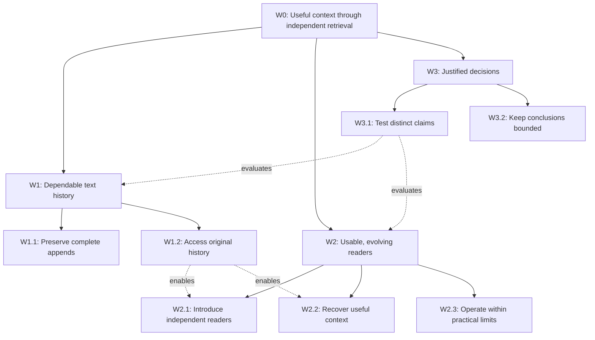

# The Pit — framing session

Date: 2026-09-30. Inputs: the current conversation, [README.md](README.md), and [AGENTS.md](AGENTS.md).

This session separates the user's confirmed requirements from framing hypotheses and candidate tactics. It selects no implementation or vendor.

**Latest implementation decision:** Supabase PostgreSQL is the preferred v1 platform. Sinks write directly to a table, and the user explicitly removed enforcement of the previously discussed 50 MB cap. See the proposed [table contract](schema.md). Earlier size-cap tests and vendor comparisons below are historical analysis, superseded where they conflict with this direction.

**Latest uniqueness decision:** The user explicitly confirmed exact-text deduplication: SHA-256 identity with conflicting inserts ignored. Earlier references to append-only history now mean the retained history of distinct texts, not a record of every repeated submission. First stored receipt time is preserved; no occurrence counts or normalization are required.

## Aim

**Aim:** Users can work with agents that recover useful context from accumulated text through their own retrieval methods, without requiring that text to be organized into a prescribed model before capture.

**Why it matters:** The user wants "Google search for context" and agents free to build their own search tools. A capture model that anticipates particular sources or interpretations constrains what future readers can do.

**Current State:** The user has established the source-independent, unstructured-text invariant. This folder contains that contract; it contains no Pit implementation. Repeated source-aware and structured-ingestion proposals in the conversation demonstrate framing drift. The conversation does not establish a measured baseline for users' retrieval behavior.

**Desired State:** Agents can access accumulated text and choose or build retrieval methods appropriate to their current task. Capturing the text does not require anticipating those methods.

### Mechanism

**Change:** An always-on append-only text corpus with an open read interface, reader-owned indexes and transforms, and computation close to the data.

**Hypothesis:** Preserving text independently of its source and exposing it to independent readers will allow useful, efficient retrieval to evolve without changing capture or rewriting the authoritative history.

**Assumptions:** The deposited text contains context useful to later tasks; readers can recover that context without a source-specific core model; efficient reader implementations can coexist with open access. These are hypotheses about usefulness and feasibility, not measured results.

**Misunderstanding Signal:** A proposal requires a source choice, content taxonomy, canonical extraction, or fixed search interface before text can be captured or an independent reader can use it. Another signal is optimizing storage throughput while agents still cannot recover useful context.

### Feedback

**Signal:** Independent readers recover relevant original text for different questions from the same corpus, without changes to the capture contract. Measure retrieval usefulness separately from latency, data movement, freshness, and integrity.

**Timeframe:** Seek the first signal in a bounded end-to-end trial once candidate solutions exist. No performance threshold or deadline has been agreed.

### Guardrails

- The core stores unstructured text and does not depend on its source.
- Preserve received text and append-only history. The user expects 99% of entries below 1 MB and has removed enforcement of the earlier 50 MB cap. Database and transport limits still apply; do not silently truncate accepted text.
- Allow minimal operational bookkeeping without interpreting content.
- Keep the read interface open so agents can build their own tools; indexes and transforms are reader-owned and replaceable.
- Retain fast retrieval and computation close to the data as requirements; exact performance targets remain open.
- Source adapters are outside this framing exercise. Make/Zapier mirroring is already an accepted starting approach.
- The Google Search analogy does not select Google's products. All previously discussed stacks remain proposals.

## Problem Space

**Known:** The core input is unstructured text; append-only history, long entries, open reads, independent retrieval tools, fast retrieval, nearby computation, and always-on operation are explicit requirements.

**Observed failure:** The design conversation repeatedly introduced source-dependent decisions and storage products before preserving the above contract. `durch/intake` was identified by the user as cautionary prior work.

**Unknown:** Workload size and rate, acceptable retrieval latency/freshness/cost, recovery expectations, and how much reusable read infrastructure agents need. No benchmark or user retrieval trial is recorded here.

**Lenses:** Agent use and outcome; system contract and operation; evidence and decision quality. These are independent views of one aim, not three levels of a design hierarchy.

**Out of scope:** Choosing sources, building adapters, introducing a semantic ingestion model, selecting vendors, implementing services, provisioning infrastructure, or creating external planning records.

## Problem Weave

**Current frame:** People want agents to recover useful context from accumulated unstructured text, with freedom to invent and change how they retrieve it. The Pit must preserve source-independent capture while making independent readers practically useful and efficient. The contract is established by explicit user direction; feasibility, usefulness, and performance are unmeasured. This exercise frames the necessary work and its tensions without choosing a stack, source, adapter, or canonical interpretation of the text.

**Layers used:** Agent use and outcome distinguishes useful work from available features. System contract and operation examines preservation, reader independence, and operational viability. Evidence and decision quality distinguishes demonstrated behavior from plausible architecture. No lens can substitute for either of the others.

**Independence:** Three agents ran separate passes from the same Aim, Problem Space, README, and AGENTS. Each received only its own lens and did not see the other outputs. The coordinator performed the normalization and synthesis below.

**Status:** Candidate framing ready for bounded solution exploration. No tactic or technology is selected. Scope and operational acceptance questions remain visible below.

**Inputs:** The Aim and Problem Space above. Evidence codes: **R** = explicit requirement documented in the conversation/README; **O** = observed state of this discussion and folder; **I** = inference; **H** = hypothesis needing a check. A requirement is evidence of intent, not proof that a system satisfies it.

### Shared Core

The corpus must remain available for interpretations that were not anticipated when text was captured. Preservation, practical reader independence, and useful retrieval reinforce each other, but none establishes the others by itself.

All three passes support these claims:

- Capturing text must not depend on source knowledge or a reader's interpretation.
- A later reader must be able to work from original text without inheriting an earlier reader's projection.
- Useful context recovery and efficient operation need separate evidence. An open API, a fast query, or the Google Search analogy does not establish both.
- Indexes can improve particular reads while remaining downstream artifacts. Their usefulness does not make them an ingestion requirement.

### Distinct Problem Statements

1. **Agent use and outcome:** Users need agents to recover and use relevant context, and to change retrieval methods as their work changes, but available storage or search features alone do not establish either ability.
2. **System contract and operation:** Core maintainers and reader authors need preserved text and usable access to remain dependable as readers evolve, but completion, recovery, traversal, reader independence, and operating behavior have not yet been demonstrated.
3. **Evidence and decision quality:** The project needs a defensible way to compare approaches, but there is currently no measured retrieval baseline, and a demonstration can reward fast or plausible output while hiding lost text, capture coupling, preparation costs, or missed context.

These remain separate: a reasonable person would take different action to fix irrelevant results, inaccessible original text, and an overstated benchmark.

### Interwoven S&T Steps

**Root strategy W0:** Users can work with agents that recover useful context through independently chosen retrieval methods, without organizing text before capture.

**Root tactic, candidate:** Advance preservation, usable independent retrieval, and evidence of both as distinct work branches. The first two establish capabilities; the third supports justified decisions about them. This is a framing decomposition, not three proposed services.

**Root metadata:** Parent: none; depth: 0; sufficiency group: G0. **Necessity:** Preserved text and usable independent retrieval are required by the Aim; evidence is needed to justify a solution decision. **Parallel assumption:** Separating those obligations will expose candidates that satisfy one while weakening another. **Owner:** Project decision owner, unassigned. **Review trigger:** First candidate evidence or a change to the Aim. **Evidence:** Requirements R; the decomposition's decision value I. **Invalidation:** See W0 in the invalidation table.

In the table, **N** identifies the necessary capability. The particular **T** is a candidate way to advance it and can be replaced. **PA** explains why that tactic is credible now. Owners are proposed roles, currently unassigned. No row authorizes implementation.

| ID | Parent | Depth | Layer | Strategy: what and why | Tactic: how | Disposition | N | PA | Owner | Review trigger | Evidence | Group / links |
|---|---|---|---|---|---|---|---|---|---|---|---|---|
| W1 | W0 | 1 | System + outcome | Maintain dependable original history so future readers have a stable basis | Describe and challenge observable preservation and access guarantees | candidate | Lost or inaccessible text defeats later retrieval | Observable guarantees constrain drift without specifying storage | Core maintainer | A candidate contract or failure case appears | R; feasibility H | G0; elaborated by G1 |
| W1.1 | W1 | 2 | System | Preserve complete received text and distinguish completed appends from partial work | Specify completion and recovery expectations; exercise interruption and long-entry boundaries | candidate | Preservation cannot depend on silent truncation or uncertain completion | Operational bookkeeping can describe state without interpreting text | Core maintainer | Interrupted append, restore discrepancy, proposed limit | R; exact semantics unknown | G1; enables W1.2 |
| W1.2 | W1 | 2 | System + outcome | Let readers traverse history and inspect sufficient original context | Describe direct/range access and replay/follow behavior, including resumability and coverage | candidate | Readers need a practical path to originals and new text | These capabilities are already in the contract; interface details remain open | Core maintainer + reader author | A fresh reader cannot traverse, resume, or expand context | R; practical usability H | G1; enables W2.1 and W2.2 |
| W2 | W0 | 1 | Outcome + system | Agents obtain useful context while being able to change retrieval methods | Assess method creation, context use, and operational practicality separately | candidate | A useful incumbent reader and future reader freedom are distinct obligations | Separating them exposes nominal openness or feature-only success | Reader author + outcome evaluator | First reader attempt or changed retrieval need | R; benefit H | G0; elaborated by G2 |
| W2.1 | W2 | 2 | Outcome + system | New readers can start, evolve, or disappear without changing capture | Examine reader dependencies and exercise a reader authored after capture | candidate | Future retrieval must not depend on prior semantic commitments | A later reader challenges what capture implicitly anticipated | Reader author + core maintainer | Reader addition, replacement, or failure affects capture | R; proposed check I | G2; depends on W1.2 |
| W2.2 | W2 | 2 | Outcome | Recovered text helps the agent's current work | Judge relevance against the task, inspect original context, and retain uncertainty about missed material | candidate | Finding text is insufficient if it does not help the task | Task-relative evaluation avoids a corpus-wide taxonomy | Agent using a reader + evaluator | Relevant-looking hits fail to help or omit decisive context | Aim R; evaluation method I | G2; depends on W1.2 |
| W2.3 | W2 | 2 | System + outcome | Nearby reader computation remains practically usable alongside capture | Assess latency, preparation, freshness, data movement, recovery, and resource competition together | candidate | Freedom that is unusably slow or disrupts availability misses the aim | Joint measurements expose costs hidden by location or warm-query claims | Operator + reader author | Workload, reader, or compute placement changes | R; limits unknown | G2; tension with W2.1 |
| W3 | W0 | 1 | Evidence | Make solution decisions proportional to demonstrated capability | Build a bounded evidence case and keep its limits attached to comparisons | candidate | Capability claims need evidence before they justify a choice | Requirements and observed drift identify what comparisons must discriminate | Project decision owner + evaluator | Candidate comparison or commitment | O; process benefit I | G0; elaborated by G3 |
| W3.1 | W3 | 2 | Evidence | Distinguish usefulness, independence, integrity, and operating conditions | Use representative text and varied questions; inspect passages; introduce a later reader; exercise long entries, appends, recovery, and rebuilding | candidate | A single success metric can hide failure of another requirement | Different checks make the competing claims inspectable without choosing a source | Evaluator with reader authors | A trial can pass while a requirement fails | R; test design H | G3; evaluates W1 and W2 |
| W3.2 | W3 | 2 | Evidence | Keep conclusions and commitments within their evidence | Record confirmed requirements, observations, assumptions, missing coverage, and accepted trade-offs beside each comparison | candidate | An unverified suggestion must not become a requirement | Drift in this conversation makes the distinction decision-relevant | Project decision owner | Before ranking or selecting an approach | O; benefit I | G3; constrains subsequent selection |

### Sufficiency Groups

| Group | Parent strategy | Child steps | Mode | Collective coverage claim | Gap or deferred branch |
|---|---|---|---|---|---|
| G0 | W0 | W1, W2, W3 | all required for this framing | Dependable history and usable independent retrieval cover the intended capability; evidence supports a justified decision that the capability exists | Conditional on useful context being present in deposited text; no production sufficiency claim |
| G1 | W1 | W1.1, W1.2 | all required | Complete preserved appends plus practical access cover a dependable readable history | Exact commit, continuation, recovery, and availability expectations remain to be specified |
| G2 | W2 | W2.1, W2.2, W2.3 | all required | Reader independence, task usefulness, and operational practicality jointly cover usable evolving retrieval | Minimum reusable reader assistance and acceptable cost/latency/freshness are unknown |
| G3 | W3 | W3.1, W3.2 | all required | Discriminating observations plus bounded interpretation cover a defensible next comparison | Finite trials do not prove all future queries, all entry lengths, or continuous availability |

Further decomposition is **deferred** at these leaves. In particular, resource controls, indexing algorithms, execution environments, persistence mechanisms, and benchmark infrastructure should be elaborated only when a candidate or disputed assumption makes them decision-changing.

### Overlap and Complement

| Relation | Nodes | Treatment and assumption |
|---|---|---|
| Overlap | SYS-1b and O1.2 → W1.2 | Merge the shared requirement to reach original text. Retain both purposes: corpus traversal and expanding a relevant passage. Keeping separate objectives would not change the access capability needed |
| Overlap | O2 and SYS-1c → W2.1 | Merge independent authoring and freedom from incumbent-reader dependencies. Retain the distinction between creating a reader and removing a failed one |
| Complement | W1 and W2 | Preserved text enables readers; readers turn it into usable context. Neither is evidence that the other works |
| Dependency | W1.1 → W1.2 → W2.1/W2.2 | Completed preserved history is the basis for meaningful traversal and original-context inspection; exact visibility semantics remain open |
| Complement, not merge | W2.2 and W3.1 | Useful task behavior differs from measuring whether it occurred. A test method must not become a mandatory agent workflow |
| Complement, not merge | W2.3 and W3.1 | Operating well differs from producing evidence of it. Benchmark instrumentation is not part of the text model |
| Dependency | W3.2 → solution selection | Selection must state which requirements are supported and which trade-offs remain; no vendor choice follows from analogy alone |
| Gap | W2.3 | What workload and operating limits make a reader useful? This is an evidence question, not a reason to choose a source |
| Gap | W1.1 | What must an acknowledgment promise, and what recovery loss is acceptable? Keep this explicit when comparing persistence designs |

No incompatible factual claim was found between the three passes. Agreement here is agreement about the framing; it is not empirical validation.

### Opposition and Uncertainty

1. **Prepared search versus unrestricted future methods.** W2.1 preserves freedom to invent queries; W2.3 seeks efficient operation. **Type:** real performance and preparation trade-off. An index may accelerate a particular method while a new method needs additional work. **Decision needed:** how readers obtain, maintain, or reuse acceleration without making it authoritative. **Owner:** reader authors and core maintainer; evaluate in solution exploration. No universal fast-query guarantee is implied.
2. **Independent computation versus continuous operation.** W2.1 can increase resource demand while W1 and W2.3 require dependable service. **Type:** resource trade-off. **Decision needed:** which execution arrangements allow useful reader freedom under load. **Owner:** operator. This does not establish a requirement for a new multi-tenant execution platform.
3. **Captured text versus searchable text.** W1.1 concerns a completed append; W2.3 includes reader freshness. **Type:** sequence and visibility semantics. **Decision needed:** how a reader exposes progress or incomplete coverage. **Owner:** core maintainer and reader author. Do not make indexing completion a condition of capture.
4. **Independent retrieval foundation versus ready-made search product.** W2.1 prioritizes agent-authored methods; W2.2 also requires useful results. **Type:** scope question. **Decision needed:** what reusable read assistance must be supplied, and what can be authored by agents. **Owner:** project decision owner, informed by attempts to build a reader. The conversation supports the independent foundation; a polished default search product is not established as required.
5. **Controlled tests versus meaningful use.** W3.1 needs interpretable checks without overfitting to planted terms or a fixed query set. **Type:** evidence limitation. **Decision needed:** combine constructed boundary cases with task-derived questions, labelling both. **Owner:** evaluator. No source selection is needed to frame or begin these checks.

**Resolved scope distinction:** Unstructured capture and structured reader artifacts are compatible. The invariant governs the core. It neither prohibits reader-owned indexes nor authorizes a canonical projection at ingestion.

### Recommended Working Frame

**Enable agents to recover useful context from preserved text while evolving their retrieval methods independently of capture.**

Treat preservation, reader independence, and practical retrieval as separate obligations. The decision-changing question is which boundaries let readers gain efficiency without making their interpretation a condition of storing or accessing text.

This frame favors examining the read/compute contract alongside the append contract before ranking storage products. It preserves the user's source-independence requirement and makes performance and scope tensions explicit. It does not select interfaces, a query language, indexes, or infrastructure.

### Alternate Frames Worth Keeping

- **An environment for agent-authored retrieval experiments.** Gives method creation and replacement greater weight. Useful if reader approaches are still changing rapidly; insufficient if experiments never produce useful task context. Provenance: outcome pass O2.
- **A continuously reconstructible text corpus.** Gives replay, recovery, and reader rebuilding greater weight. Useful when preservation/recovery is the decisive uncertainty; insufficient as a complete product frame if retrieval remains impractical. Provenance: system pass SYS-1.
- **A ready-to-use context search service.** Would prioritize an owned default retrieval experience, quality, and support. It materially expands what the project must supply and is not selected by this conversation. Preserve it as a scope alternative, not as a hidden assumption. Provenance: coordinator synthesis of O1/O2 and E1a/E1b tension.

### Evidence and Invalidation

The highest-value cross-layer check is a reader authored **after capture** that works from original text without changing capture or depending on an incumbent reader's semantic projection. Passing it would support independence, not prove universal retrieval quality or speed.

| Step | Observable invalidation or reason to revise |
|---|---|
| W0 | Agents cannot obtain useful context without changing the confirmed capture contract; first determine whether the failure is the candidate mechanism or an unsupported outcome assumption |
| W1 | Original text exists nominally but independent readers cannot depend on or access its history |
| W1.1 | Truncation, mutation, or a completed acknowledgment that cannot be reconciled with recoverable text under the declared failure model |
| W1.2 | A reader cannot traverse/resume or inspect needed original context without a privileged search path or canonical projection |
| W2 | Method creation succeeds but useful work does not, or useful work requires surrendering independent methods |
| W2.1 | Adding or replacing a reader requires source-aware ingestion changes, or removing one breaks other readers or capture |
| W2.2 | Retrieved material resembles the query but does not support the task; another reader reveals consequential omissions |
| W2.3 | The apparent performance advantage disappears when preparation, rebuilding, freshness, data movement, and competing work are counted |
| W3 | The evidence process cannot distinguish a contract-violating candidate from a compliant one |
| W3.1 | Tests pass through answer leakage, a shared mandatory projection, hidden missed coverage, or fluent answers unsupported by returned passages |
| W3.2 | Unmeasured claims become commitments, or the record adds administration without improving decisions and should be simplified |

**Evidence still needed:** Relevant-passage usefulness, independent-reader feasibility, preservation under failure, long-text handling, and operational measurements tied to named workloads. Latency, freshness, recovery, cost, and acceptable reader-development effort remain unquantified. Record misses and unknown coverage separately from evidence that a corpus lacks an answer.

**What would invalidate this synthesis:** If the desired outcome is satisfied by a fixed retrieval interface and agent-authored methods are no longer needed, the independence branch needs reconsideration with the user. If efficient useful retrieval is achievable only by changing the unstructured/source-independent core, the candidate approach conflicts with the invariant; it does not get to silently redefine the invariant.

### Provenance and Normalization

| Pass | Agent | Original framing excerpt | Evidence status |
|---|---|---|---|
| Outcome | `/root/pit_weave_outcome` | "Users need agents to recover and use relevant context from accumulated text, and agents need freedom to invent or change retrieval methods as their work demands." | Intent supported by Aim; effectiveness untested |
| System | `/root/pit_weave_system` | "useful context retrieval must improve without changing capture" | Confirmed direction; operational feasibility untested |
| Evidence | `/root/pit_weave_evidence` | "storage capability alone does not establish retrieval value" | Causal distinction; no measured baseline |

| Original steps | Normalized location | Decision made during normalization |
|---|---|---|
| O0, SYS-0, E0 | W0 and G0 | Preserve their different roles: user capability, system feasibility, and justification. Do not equate evidence production with the user outcome |
| SYS-1, SYS-1a | W1, W1.1 | Keep externally observable preservation and recovery; defer mechanisms |
| SYS-1b, O1.2 | W1.2 | Merge access to originals with traversal while retaining both purposes |
| O2, SYS-1c | W2.1 | Merge independent authoring and reader lifecycle freedom |
| O1, O1.1, O1.3 | W2, W2.2 | Compress task-relative relevance and appropriate use. These are evaluation/reader concerns, not mandatory core features or a prescribed agent reasoning procedure |
| SYS-2 | W2.3 | Retain operational viability; do not infer numeric budgets, infrastructure, or that same-region placement alone establishes speed |
| E1, E1a, E1b, E1c | W3.1; checks linked to W2.1–W2.3 | Keep trial tactics distinct from product capabilities. Constructed fixtures are not evidence of user behavior |
| E2 | W3.2 | Keep claims proportional to evidence; the representation itself is replaceable |

The original sufficiency groups O-G0/O-G1, SYS-G0/SYS-G1, and the evidence pass's G0/G1 are normalized into G0–G3 here. Their coverage claims remain conditional and their gaps remain visible. No pass selected a tactic. The coordinator did not promote any to selected.

### Ready for Next Phase?

**Yes, for bounded `/solution-space` exploration; no, for implementation planning or a final stack decision.** Source independence is settled. The material trade-offs above are visible rather than hidden. Candidate solutions can expose how they handle those trade-offs while operational acceptance values remain open.

### Next Route

Compare candidate ways to provide **open reading and nearby computation over the append-only text history**. For each, ask what a new reader needs to become useful and efficient, and what that implies for persistence. Carry forward W1–W3 and reject any candidate that moves interpretation into capture. Do not choose a source or build adapters as a prerequisite.

### Wiring Follow-up

**Offer:** After the working frame is accepted, `$record` could preserve the candidate outcome, capabilities, signals, and guardrail below. These are local candidates only. No canonical outcome IDs or external records have been created; record routes require normalization and confirmation of the parent outcome.

**Plan gate:** No tactics are selected. `/oh-plan` is deferred until `/solution-space` explicitly selects S&T step IDs and resolves the trade-offs affecting those branches. A future planning handoff must retain each step's parent, sufficiency group, owner, review trigger, acceptance signal, and dependencies.

| ID | Type | Artifact | S&T step | Parent step | Group | Disposition | Owner / review trigger | Record route | Planning route |
|---|---|---|---|---|---|---|---|---|---|
| A1 | outcome | Agents recover useful context without pre-organizing captured text | W0 | none | G0 | candidate | Decision owner / outcome evidence changes | `$record outcome`; establish canonical parent for A2/A3 | deferred |
| A2 | capability | Dependable access to preserved text history | W1 | W0 | G0, G1 | candidate | Core maintainer / preservation or traversal failure | `$record capability` under A1 after normalization | deferred |
| A3 | capability | Readers evolve independently and remain practically useful | W2 | W0 | G0, G2 | candidate | Reader author / new or replaced reader | `$record capability` under A1 after normalization | deferred |
| A4 | signal | A later reader recovers useful originals without capture changes; operational conditions accompany results | W3.1 | W3 | G3 | candidate | Evaluator / a trial hides a failure mode | `$record signal` linked to A1–A3 after normalization | deferred |
| A5 | guardrail | Core behavior never depends on source identity or a semantic interpretation of the text | W1, W2.1 | W0, W2 | G0, G2 | candidate external record; invariant already confirmed | Core maintainer / proposed capture or access change | `$record guardrail` after normalization | deferred |

## Solution Space

**Subsequent user decision:** Entries are capped at 50 MB (50,000,000 UTF-8 bytes), superseding this session's earlier unbounded-length assumptions. Read historical references to long entries against that cap. For current selection, a native value-size limit is disqualifying only if it prevents supporting the agreed 50 MB entry; segmentation and entries larger than working memory are not mandatory. R2 now checks exact preservation and reads through 50 MB, measured memory use, and explicit rejection above the cap without partial publication or truncation. Unbounded-size tests and the earlier PostgreSQL 1 GB field-limit objection no longer apply.

**Expected workload:** The user estimates that 99% of entries will be under 1 MB. Use this assumption to evaluate common-case performance; retain 50 MB boundary checks. The distribution has not been measured.

**Later revision, 2026-09-30:** The concrete multi-service realization of option C was withdrawn after user feedback. Reopen option A, an integrated engine, with ClickHouse as an unvalidated candidate. The earlier recommendation below remains analysis history; it does not authorize building the withdrawn stack. See the [implementation note](implementation-recommendation.md). The core invariant and reader-independence requirements remain unchanged.

Date: 2026-09-30. This section advances the earlier candidate weave into a recommended approach and bounded verification handoff. **Selected** below means selected by this analysis for that proof; it does not mean deployed, empirically validated, or a user-confirmed vendor decision. The preceding weave remains a record of the independent framing passes.

### Solution Space Analysis

**Problem:** Enable agents to recover useful context with methods they can invent after capture, while preserving complete unstructured text and practical retrieval performance.

**Key Constraint:** Core capture and access cannot depend on the source or any reader's semantic interpretation.

**Working Story:** Stable, source-independent text history can support changing reader methods. Reader programs can gain speed through their own indexes, caches, and transforms, executed close to the text. The Pit need not anticipate those methods or supply a new agent harness.

**Success Signal:** A reader authored after capture retrieves useful original passages through the public-to-readers contract while an earlier reader and its index are unavailable. Long text, fresh appends, recovery, and preparation costs remain visible in the result.

**Decision Criteria, in order:**

1. Preserve received text, history, and discoverability of completed appends under a declared recovery model.
2. Support genuinely independent reading and reader code; a built-in query language cannot be the sole route to the corpus.
3. Accommodate long entries through streaming and physical segmentation without semantic preprocessing or silent loss.
4. Support useful retrieval and nearby computation, judged by complete preparation/query/freshness/data-movement costs.
5. Minimize machinery owned by the project, while retaining a credible path to always-on operation and recovery.

**Early eliminators:** Mandatory source routing or content projections; a fixed maximum logical entry length imposed by a database cell or search event; inaccessible originals; indexes required before capture succeeds; and an acknowledgment whose preservation promise fails under its declared recovery conditions. A table containing only text and operational bookkeeping is not disqualified merely because it is a table.

**Critical Assumptions:**

- C1: Independent general-purpose reader code is materially useful beyond a single engine's extension surface.
- C2: Existing compute facilities can run that code near storage without building a scheduler or execution platform.
- C3: Immutable text storage and a durable append journal can provide complete recovery without excessive coordination machinery.
- C4: Reader-owned acceleration can provide acceptable performance despite preparation, replication, and freshness costs.
- C5: Representative text and questions can expose contract failures before source integration; later user judgment is still needed for real usefulness and acceptable operating costs.

There is no functioning Pit to retain as a status quo. The four candidates below were generated before evaluation. They differ in who owns retrieval and execution, not merely in database brand.

### Candidates Considered

| Option | Level | Approach and assumed frame | Does it solve the problem? | Main cost / second-order consequence | Disposition |
|---|---|---|---|---|---|
| A — Database with programmable queries | Local Optimum | Store text with minimal operational fields and let agents use SQL, indexes, and functions. Assumes a common query engine covers most useful reader methods | Potentially. Long logical entries and independent access beyond the engine must be demonstrated | Operate or buy the engine; adapt methods to its execution and value-size constraints. May provide less machinery than C, or make the engine's model the effective read contract. Risks R2, R4, R8 | deferred as primary; retain as the strongest integrated comparator |
| B — Extensible search platform | Local Optimum | Make a search engine the main read environment and let agents extend its query/command surface. Assumes a ready-made search product is the main need | Can supply useful indexed retrieval. Complete preservation and truly independent reads require separate proof | Index/event processing, extension lifecycle, and platform operation. A convenient first index may become indispensable. Risks R1, R2, R4, R6 | deferred as primary; remains a possible reader inside C |
| C — Raw text history with independent nearby readers | Reframe | Keep capture/history stable; run ordinary reader programs near it, each owning any derived state. Assumes reader independence is a first-class capability | Best direct fit to the confirmed contract; usefulness, recovery, and cost still need proof | We own the minimal append/read boundary and its recovery behavior. Readers own acceleration; preparation and duplicated artifacts can cost more than an integrated engine. Risks R3–R10 | selected for bounded proof |
| D — Storage-only service, consumer-owned compute | Reframe | Provide durable append/read/follow; existing agent environments arrange retrieval and compute placement. Tests whether the Pit needs to own any reader execution | Yes if those environments already provide useful near-data execution. Otherwise it leaves locality and repeated data movement unresolved | Lowest Pit-side scope; shifts deployment and performance work to each consumer. Risks R5, R8, R9 | deferred as complete solution; retain as the minimum-machinery comparator |

These approaches can share components. For example, C can use a database for its journal and BigQuery as one reader. That does not make a database the mandatory execution model for every reader. D can supply C's execution arrangement if an existing harness already operates beside the text.

### Decision-Changing Evidence

Current documentation establishes capabilities and constraints, not comparative performance:

- **A is a credible alternative.** BigQuery supports indexed text lookup and managed Python functions with packages and external-service access. It should not be dismissed as only a full-scan SQL warehouse. Its execution model still has documented runtime/resource limits. [Search indexes](https://docs.cloud.google.com/bigquery/docs/search), [Python functions](https://docs.cloud.google.com/bigquery/docs/user-defined-functions-python).
- **One entry per database value is not the logical contract.** PostgreSQL documents a 1 GB field limit. This eliminates a naive single-value implementation for unbounded logical entries, not all database-backed designs. Physical segmentation or another storage mechanism remains possible. [PostgreSQL limits](https://www.postgresql.org/docs/current/limits.html).
- **B has real programmability and real ingestion assumptions.** Splunk can invoke custom Python search commands. Its documented line-breaking/truncation behavior requires explicit preservation checks; configurable limits are not proof that Splunk is fundamentally incapable. [Custom search invocation](https://help.splunk.com/splunk-cloud-platform/search/search-reference/10.1.2507/search-commands/script), [event processing](https://help.splunk.com/en/splunk-cloud-platform/get-data-in/get-started-with-getting-data-in/10.2.2510/configure-event-processing/configure-event-line-breaking).
- **Object storage supplies useful primitives, not a complete log.** Cloud Storage supports resumable uploads and range downloads. Completed objects are immutable within their generation, but names can be replaced. Its atomicity guarantee is for individual operations on objects; it does not by itself establish an ordered, recoverable multi-object append history. [Uploads](https://docs.cloud.google.com/storage/docs/resumable-uploads), [downloads](https://docs.cloud.google.com/storage/docs/downloading-objects), [object behavior](https://docs.cloud.google.com/storage/docs/objects), [consistency](https://docs.cloud.google.com/storage/docs/consistency).

**Inference from the evidence:** Object storage is a plausible persistence class for C's raw text, while engines such as BigQuery or Splunk remain usable downstream. Documentation does not settle whether C is faster, cheaper, or simpler than a compliant A or D. That comparison stays in the risk plan.

### Interpretive Variety Check

- **A assumes** most useful computation can be expressed through one engine and its extension model.
- **B assumes** immediate indexed search is the central product, with customization added to it.
- **C most directly tests the current frame:** preserving text independently lets later agents choose their own retrieval methods.
- **D challenges ownership:** perhaps existing agent environments already provide the execution ability and the Pit only needs storage/access.
- **Failure would teach:** If C's reader independence can be achieved more simply through A, use the integrated implementation without surrendering the invariant. If D already supplies local execution, remove Pit-owned hosting. If no reader can recover useful context without changing capture, reject that candidate mechanism and revisit the framing explicitly; do not silently add source structure.

### Risk Retirement Plan

**Status convention:** “Retired by evidence” in this table is a *planned disposition*. Every execution check below is **pending**; no risk is claimed retired by an unrun test. “Accepted with rationale” preserves an explicit limit on what this analysis claims. “Triggered” names a condition that must change the approach.

| Risk / assumption / alternate frame | Planned disposition | Tempting patch this must fail | Required evidence or rationale | Stop/pivot if |
|---|---|---|---|---|
| R1 — Reader interpretations become capture rules | Retired by evidence — pending | Support “generic text” through hidden source parsers, normalization, or one required extraction | Preserve varied literal text exactly, including whitespace and Unicode distinctions; inspect capture dependencies; alter or omit external origin labels without changing content handling | Capture behavior requires knowing the source or an index's schema |
| R2 — Logical length inherits physical limits | Retired by evidence — pending | Raise a field/event limit or buffer an entire append in memory | Stream an entry larger than the configured working-memory budget and multiple physical units; verify exact reconstruction and original ranges; use very small test segment sizes to force boundary cases; exercise a reader match across a boundary | Memory grows with complete-entry size, text is lost, or storage segmentation becomes a semantic boundary |
| R3 — Durable text loses acknowledged history on recovery | Retired by evidence — pending | Put text in a bucket but keep the only receipt/order information in a host-local catalog | Interrupt every publication stage; retry; reconstruct on a fresh host from the declared durable authorities. Every acknowledged append must retain its identity, order, text, and readability under the stated failure model; distinguish uncommitted uploads | Payloads survive but acknowledged history cannot be found or ordering cannot be recovered |
| R4 — Apparent reader freedom hides one mandatory index | Retired by evidence — pending | Demonstrate two wrappers over the same search projection | Freeze the capture contract, then author a materially different reader using only raw access; make the first reader's index unavailable; retrieve and verify original passages, including long-entry surroundings | The second reader needs capture changes, private interfaces, or the first semantic projection |
| R5 — Nearby computation still causes excessive scans | Retired by evidence — pending | Move a full-corpus download loop into the same region and call it fast | Count data fetched, preparation time, cold/warm query time, repeated work, cache behavior, and rebuild cost on identical text/questions. Compare with a compliant A or D baseline under the same declared resources | C requires materially greater work without delivering needed independence; or meeting the workload requires changing capture |
| R6 — An index hides freshness or coverage gaps | Retired by evidence — pending | Block capture on indexing or report no results while unindexed text is omitted | Append while an index is paused; verify committed text through raw reads; require that reader's test result to expose its covered position or lag. Resume/rebuild without rewriting capture | Accepted text is inaccessible through raw reads, or a partial reader silently claims complete coverage |
| R7 — Synthetic speed is mistaken for useful context | Retired by evidence — pending; human usefulness judgment remains | Pass only planted-keyword queries or score fluent answers without original support | Use both controlled boundary cases and held-out, task-derived questions. Inspect returned original passages, absent/ambiguous answers, and consequential misses. Label constructed cases and ground-truth limits | Success disappears on questions not used to shape the first reader, or answers lack supporting retrieved text |
| R8 — C builds unnecessary execution machinery; A or D already suffices | Retired by evidence — pending | Build a scheduler/plugin system before trying ordinary execution, or dismiss SQL functions without testing them | Use existing process/container/job facilities for two reader methods; inspect whether an existing agent environment already supplies near-data execution. Compare the concrete setup with a minimal compliant A/D baseline, including operating steps and required privileges | A or D meets the same contract with materially less machinery; adopt that arrangement and retain the invariant |
| R9 — Reader work disrupts dependable capture/access | Retired by evidence — pending | Validate only idle, single-reader performance | Run a bounded expensive reader alongside appends and a simple read. Observe queueing, resource use, completion/recovery behavior, and whether an existing execution facility can control the workload without narrowing read expressiveness | Useful reader freedom repeatedly requires unavailable capture or weakened preservation |
| R10 — Free choice entails preparation, duplicated state, and variable freshness | Accepted with rationale | N/A — accepted, measured through R5/R6 | Reader-owned acceleration may duplicate work and cannot guarantee equally fast arbitrary queries. Those costs remain visible; production acceptability needs user judgment on measurements | The costs prevent useful retrieval; revisit the execution/index arrangement rather than the text invariant |
| R11 — Unmeasured budget, scale, and availability expectations | Accepted with rationale for bounded exploration only | N/A — accepted | No numeric operating target is user-confirmed. Publish actual workload and measurements, and seek acceptance before a paid production commitment or a performance promise | A design choice depends on pretending unknown thresholds are already accepted |
| R12 — Core contract can only be met by adding a content model | Triggered | N/A — trigger | Any proposed source-specific ingestion, mandatory semantic projection, or sole fixed search gateway conflicts with the confirmed contract | Reject the candidate or return to explicit framing discussion; do not weaken the invariant during execution |

R1–R4 are correctness and independence gates for the bounded proof. R5–R9 decide practicality and complexity. Passing them on one workload does not establish universal performance or retirement for every future workload.

### Recommendation

**Selected:** Option C — source-independent text history with independent readers running close to it.

**Level:** Reframe.

**Rationale:** This assigns meaning and acceleration to the agents/readers that need them, while preserving the ability to use future methods. It most directly matches the user-defined open read interface and avoids making the first search method authoritative. It also gives existing query engines a clear place without making one engine the system's permanent limit.

**Concrete reference shape for the first proof:**

- Store original text in immutable objects/segments with a durable append journal. Prefer object storage as the initial storage class. GCS is a reference candidate, not a selected cloud commitment.
- Stream appends and reads. Keep only the operational information needed to locate, order, verify, and recover completed text. Reuse an established commit primitive; the experiment must expose any cross-store recovery gap before a public contract is fixed.
- Make the committed corpus directly readable and replayable independently of search. Readers can retrieve ranges and follow new appends.
- Run ordinary reader programs on existing compute beside storage, with local working space for their own indexes/caches. A colocated host or an existing job service can supply this; a custom scheduler, agent harness, or plugin language is not part of the recommendation.
- Prove the boundary with a basic reader and a later, independent reader. Their algorithms are trial artifacts, not a mandated retrieval pipeline. A database, full-text engine, or custom scan can be used inside a reader.

Object storage alone is insufficient: publication and recovery of the append history must be designed and verified with it. Choosing a catalog implementation is a bounded follow-on decision under R3, not permission to add a content schema. The public API and physical layout remain provisional during the proof.

**Accepted trade-offs:**

- C requires an append/read and recovery boundary that a single engine may already provide. Its extra work must survive comparison with A.
- Readers pay for or reuse their own preparation; duplicate artifacts and cold starts are possible.
- Committed text and a particular reader's searchable coverage can advance at different times. Readers must make that difference observable.
- “Near the data” is a placement requirement; good access patterns still need measurement.
- The first recommendation establishes an architecture boundary, not high availability, a cost promise, a universal query-latency guarantee, or a new hosted execution product.

### S&T Selection

All required parent and sibling groups are retained for a **bounded end-to-end proof**. The selected assessment tactics are not a mandate to build every possible reader or operating feature. Owners below are role assignments for handoff; the current implementation/evaluation work can be performed by the assistant, with user judgment reserved for utility and operating acceptance.

| Step ID | Disposition | Parent | Sufficiency group | Why this disposition | Owner | Review trigger |
|---|---|---|---|---|---|---|
| W0 | selected | none | G0 | Preserve the Aim across the complete proof | Project decision owner | Aim changes or the proof contradicts it |
| W1 | selected | W0 | G0; children G1 | Reader freedom requires dependable original history | Core implementer | Preservation/access failure |
| W1.1 | selected | W1 | G1 | R1–R3 test complete appends, long text, and recovery | Core implementer | Interruption, retry, or restore discrepancy |
| W1.2 | selected | W1 | G1 | R2/R4/R6 test original access, ranges, and continuation | Core implementer + reader author | A reader cannot traverse, resume, or expand context |
| W2 | selected | W0 | G0; children G2 | Prove useful independent reading, not storage alone | Reader author + evaluator | Method creation or use fails |
| W2.1 | selected | W2 | G2 | R4/R8 test a later reader and existing execution facilities | Reader author | A new reader depends on capture changes or bespoke hosting |
| W2.2 | selected | W2 | G2 | R7 ties returned text to the retrieval task | Evaluator; user judges utility | Hits do not support the task |
| W2.3 | selected | W2 | G2 | R5/R6/R9 test preparation, locality, freshness, and competition | Operator/evaluator | Workload or execution arrangement changes |
| W3 | selected | W0 | G0; children G3 | The proof must support a bounded implementation decision | Evaluator | Candidate comparison or commitment |
| W3.1 | selected | W3 | G3 | Run discriminating checks R1–R9 instead of an agreeable demo | Evaluator | A check also passes the named wrong patch |
| W3.2 | selected | W3 | G3 | Keep findings, pending checks, and accepted costs distinguishable | Project decision owner + evaluator | Before accepting a stack or external commitment |

**Selected-step sufficiency:** G1 covers preservation/access, G2 covers independent useful operation, and G3 covers checking and interpreting both; G0 retains all three. This is sufficient to organize the next proof. It is not evidence of production readiness. No earlier tactic is disproven and therefore none is labelled rejected. Production hardening, numeric service targets, a default search product, distributed scheduling, and specific vendors remain deferred.

### Execution Handoff

- **Preserve:** Source-independent unstructured text, append-only history, logical entry length independent of storage units, direct open reads, and reader-owned interpretation.
- **Verify via:** R1–R4 correctness/independence gates, R5–R9 practical comparisons, and original passages supporting retrieval tasks.
- **Decision criteria:** Apply the ordered criteria above. Compare complete costs and operating work against a compliant integrated engine or existing reader environment; do not optimize only a warm query.
- **Critical assumptions:** C1–C5 remain hypotheses. The strongest unresolved one is whether independent nearby readers deliver enough benefit over A/D to justify the extra boundary.
- **Accepted trade-offs:** R10/R11 and the recommendation's explicit costs. No absent numeric target may be converted into a pass result.
- **Risk retirement checks:** R1–R9 are planned/pending and each names the wrong patch it must fail. R10/R11 stay accepted with limits; R12 is a hard pivot trigger. Preserve failed and incomplete observations.
- **Invalidated if:** Independent readers require changing capture, preserving complete history fails, or a simpler compliant alternative provides the same needed capability with materially less work.
- **Stop/pivot triggers:** Use the last column of the risk table. A failed candidate does not authorize changing the invariant. A successful existing execution arrangement should remove proposed hosting machinery.
- **Needs human verification:** Whether recovered context helps real work and whether measured cost, latency, freshness, and recovery behavior are acceptable for production. These are later acceptance judgments, not prerequisites to this analysis.
- **Bounded next action:** Implement and exercise one provisional append/read path and two independent readers, including the later-reader and recovery challenges. Use representative unstructured text; no source/adapter work. Complete the evidence comparison before fixing a public interface or provisioning a paid production deployment.
- **Planning route:** Only selected W step IDs may enter `/oh-plan`, retaining parents, groups, checks, owners, triggers, and trade-offs. No external issues or records were created by this analysis.

## Dissent

### Dissent Report

**Decision under review:** Prefer C's stable text-history boundary and independent nearby readers, with object storage as the reference persistence class.

**Stakes:** A premature read interface, publication model, or hosted runtime can become difficult to replace. The bounded proof is reversible; a production contract would be harder to change.

**Confidence before dissent:** Medium, based on requirement fit rather than comparative measurements.

### Steel-Man Position

C keeps capture independent of anticipated questions, allows agents to introduce new algorithms after text exists, and lets each reader choose useful acceleration close to the corpus. Existing storage and execution facilities can realize it without a bespoke retrieval language. It directly serves the user's explicit invariants.

### Contrary Evidence

1. A is stronger than the earlier conversation implied: current BigQuery documentation includes search indexes and managed Python functions. An integrated engine might meet the needed read freedom with less work. R4/R8 must compare actual constraints rather than dismissing SQL by analogy.
2. Object storage atomicity is per object. The preferred persistence class introduces a publication/recovery question that a transactional engine may already handle. R3 must fail a bucket-plus-fragile-local-catalog implementation.
3. The conversation provides no comparative workload measurements and does not establish a need for a new reader-hosting platform. D may already provide the execution arrangement. R5/R8 must be able to remove unnecessary components.

The documentation links supporting these points appear in Decision-Changing Evidence. They contradict an overconfident choice of C, not the user's invariant.

### Pre-Mortem Scenarios

1. **Functional failure:** Original text survives but its receipt catalog or traversal state does not; acknowledged history becomes inaccessible. Warning sign: recovery tests verify object presence rather than exact readable history. Check: R3.
2. **Adoption failure:** The raw interface is open, yet authoring a useful reader takes too much work or misses relevant context. Warning sign: demonstrations show extensibility and keyword speed without task support. Checks: R4/R7/R8.
3. **Opportunity cost:** The project builds orchestration, caches, and a query framework before proving that ordinary execution or a database already suffices. Warning sign: infrastructure grows before the second independent reader works. Checks: R5/R8.

### Hidden Assumptions

| Assumption | Evidence | Risk if wrong | Test |
|---|---|---|---|
| Independent programs need freedom beyond one engine | User explicitly requires independent search tools; engine insufficiency unmeasured | C adds machinery without additional useful capability | R4/R8 against compliant A |
| Useful nearby execution already exists | General execution facilities exist; no project deployment verified | We accidentally commit to operating a platform | R8 against D; retain only necessary setup |
| Complete append history can recover with the selected persistence arrangement | Provider primitives documented; combined mechanism unbuilt | Surviving text loses identity/order/discoverability | R3 fresh-host recovery |
| Reader-owned indexes keep total cost practical | Plausible mechanism; no measured results | Preparation and repeated scans overwhelm query benefits | R5/R6/R9 |

### Reconstructed Story

- **Still true:** The authoritative input is unstructured text; interpretation and acceleration belong to readers; direct access stays open.
- **Weakest assumption:** C provides enough practical reader freedom beyond the simpler alternatives to justify its own boundary and operational work.
- **Changed situation model:** C is a topology to prove, not a mandate to own a compute platform or commit to a bucket/catalog combination now. Database and storage-only alternatives stay live adversarial comparators.
- **Changed beliefs:** Confidence in requirement fit remains high; confidence in operational superiority remains unestablished. BigQuery's viability as a reader or integrated comparator is stronger than earlier discussion suggested.
- **Next action:** The bounded proof and adversarial checks in the Execution Handoff.

### Decision

**Recommendation:** ADJUST.

**Reasoning:** Preserve C's boundary while making the implementation selection defeasible by simpler alternatives. No evidence yet establishes a production winner.

**Adjustment incorporated above:** Use existing execution facilities; require complete history recovery rather than object survival; compare full preparation/query costs; keep A/D capable of winning; freeze neither public API nor vendor before the checks.

**Confidence after dissent:** Medium in the recommended next action; no claim of validated production architecture.

**Follow-up artifact:** This session is the decision note. An implementation ADR should follow only after the concrete persistence/execution choice has evidence; no ADR or external commitment was created here.
